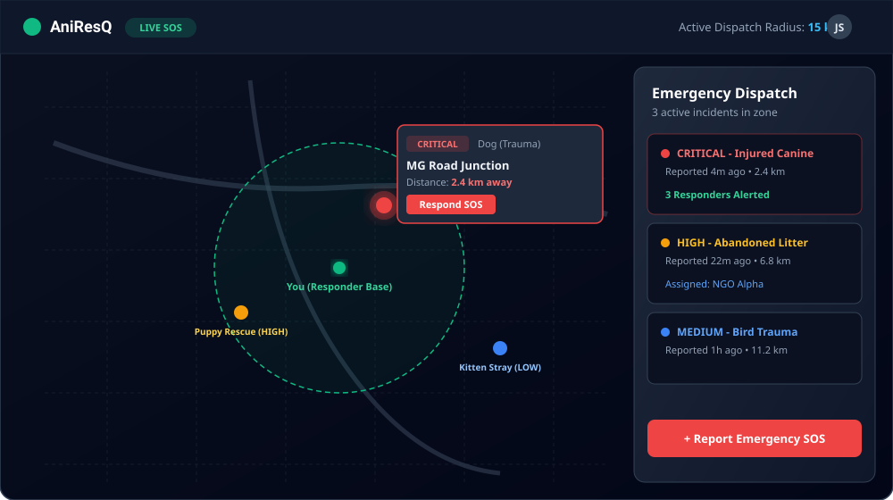
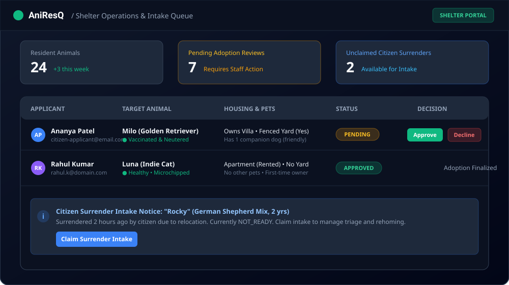

# AniResQ

A community-driven animal rescue, adoption, and lost-and-found management platform.

[](https://react.dev/)
[](https://vitejs.dev/)
[](https://www.typescriptlang.org/)
[](https://fastapi.tiangolo.com/)
[](https://www.python.org/)
[](https://supabase.com/)
[](https://tailwindcss.com/)
[](LICENSE)

---

## Architecture & Technology Stack

AniResQ is engineered as a Turborepo monorepo with a decoupled FastAPI Python backend, a Vite + React modern frontend, and a managed Supabase database, authentication, and object storage layer:

- **Frontend (`apps/web`)**: Single-page application built with React 18, Vite, Tailwind CSS, TanStack React Query, Zustand, React Hook Form, Leaflet, and Lucide icons.
- **Backend API (`apps/api`)**: High-performance RESTful API built with FastAPI, Pydantic v2, HTTPBearer JWT token authentication, Pytest, and the Supabase Python SDK.
- **Database & Auth (`Supabase`)**:
  - **PostgreSQL**: Relational schema with strict foreign keys, enum types, automatic timestamp triggers, and Row-Level Security (RLS).
  - **GoTrue Auth**: Secure JWT-based authentication with role verification.
  - **Storage**: Storage bucket (`uploads`) with public read, authenticated upload, 10MB size limit, and image MIME type restrictions.
- **Shared Packages**:
  - `packages/shared-types`: Common interfaces, enums, and domain definitions shared across the monorepo.
  - `packages/validation`: Zod validation schemas for forms and API contracts.

---

## Key Features

1. **Emergency Rescue Operations (SOS)**
   - Real-time incident reporting with GPS reverse geocoding and image attachments.
   - Interactive Leaflet live map showing nearby rescues and priority color tags.
   - Dispatch system for assigning volunteers and logging chronological timeline events.
2. **Adoption Center & Animal Surrenders**
   - Listings directory with health status, medical history, age estimates, and vaccination records.
   - Citizen animal surrender request submission with intake review pipeline.
   - Comprehensive multi-step adoption application submission and staff review screening.
3. **Lost & Found Network**
   - Community bulletin board for missing and found animals with location coordinates.
   - Interactive comment and update threads for coordinating reunions.
4. **Role-Based Access Control (RBAC)**
   - 6 distinct roles: `CITIZEN`, `VOLUNTEER`, `NGO`, `SHELTER`, `VET`, and `ADMIN`.
   - Hardened with database-level triggers and RLS against unauthorized privilege escalation.

---

## Visual Showcase & Core Modules

AniResQ is built around 4 map-driven, interactive workflows for citizens, field responders, and shelter personnel:

### 1. Interactive Emergency SOS Map & Incident Triage


*Preview / UI Illustration: Real-time Emergency SOS Command Map & Incident Dispatch Queue*

- **Live Spatial Map**: Powered by React-Leaflet, displaying open rescue incidents color-coded by severity (`CRITICAL`, `HIGH`, `MEDIUM`, `LOW`).
- **Privacy-Preserving Public Markers**: Public endpoints obfuscate GPS coordinates to ~1.1 km precision, protecting citizens from harassment while mobilizing local help.
- **Incident Dispatch Timeline**: Volunteers and NGOs accept assignments, log chronological triage updates, and coordinate veterinary transfers.

### 2. Shelter Intake & Adoption Management Queue


*Preview / UI Illustration: Shelter Intake Pipeline and Multi-Step Adoption Application Screening*

- **Intake Pipeline**: Citizens surrender animals into the system (`NOT_READY` state). Shelters review, atomically claim, and transition animals to `AVAILABLE`.
- **Staff Review Queue**: Dedicated shelter dashboard queue using PostgREST inner joins (`animals!inner(shelter_id)`) to review adoption applicants, approve/reject screenings, and notify applicants in near real-time (5s polling queue).
- **Role-Gated Clinical Updates**: Registered `VET` personnel can update clinical medical fields (`healthStatus`, `vaccinations`, `isNeutered`, and `specialNeeds`) on any animal without administrative shelter ownership blocks.

### 3. Geofenced Responder Alerting (Haversine & PostGIS)
- **Private Volunteer Base Coordinates**: Responders can set their dispatch base and service radius (5–50 km) securely in their profile.
- **Database Distance RPC**: A `SECURITY DEFINER` Haversine RPC calculates great-circle distance server-side. Coordinates are never exposed to clients or unauthenticated callers.
- **Batched Dispatch**: When high-priority emergencies occur, the backend notifies nearby volunteers in a single batch notification.

### 4. Community Lost & Found Bulletin
- **Public Community Board**: Neighborhood missing pet alerts with last-seen markers, clear privacy disclosures, and contact details.
- **Direct Sighting Threads**: Chronological community sightings and comment threads facilitating rapid reunions.

---

## Type Safety & Schema Synchronization (FastAPI to TypeScript)

To prevent contract drift between backend Pydantic v2 schemas and frontend forms/services, AniResQ provides automated OpenAPI schema extraction and TypeScript definition generation, enforced via CI:

```bash
# 1. Export FastAPI OpenAPI JSON spec and generate client TypeScript interfaces
pnpm run generate:openapi
# - Extracts OpenAPI spec to packages/shared-types/openapi.json (with fallback env vars)
# - Runs openapi-typescript to produce packages/shared-types/src/api.d.ts

# 2. CI Contract Enforcement
# The contract-ci GitHub Actions job regenerates the spec and runs:
# git diff --exit-code packages/shared-types/openapi.json packages/shared-types/src/api.d.ts
# Ensuring pull requests fail if API schema modifications drift from committed types.

# 3. Hybrid TypeScript/JavaScript frontend
# apps/web is configured with tsconfig.json (allowJs: true) and imports
# generated OpenAPI types from @aniresq/shared-types.
```

---

## Geospatial & Real-time Scaling Roadmap

- **PostGIS Spatial Engine**: For high-volume spatial scaling, the database schema is architected to transition from Haversine trigonometric queries to native PostGIS geometry/geography indexing:
  ```sql
  CREATE EXTENSION IF NOT EXISTS postgis;
  CREATE INDEX idx_users_location_gist ON public.users USING GIST (
    ST_SetSRID(ST_MakePoint(longitude, latitude), 4326)::geography
  );
  ```
- **Supabase Realtime SOS Channels**: Enables instant push dispatch to active volunteer dashboards over WebSocket subscriptions without polling:
  ```javascript
  const channel = supabase.channel('realtime:rescues')
    .on('postgres_changes', { event: 'INSERT', schema: 'public', table: 'rescues' }, (payload) => {
      // Instantly pin new emergency marker to Leaflet map
    })
    .subscribe();
  ```

---

## Prerequisites

- **Node.js**: 18.0.0 or higher
- **pnpm**: 9.0.0 or higher
- **Python**: 3.10 or higher
- **Supabase Account**: A free project hosted on [supabase.com](https://supabase.com) (or a local Supabase CLI instance).

---

## Getting Started

### 1. Clone the Repository

```bash
git clone https://github.com/Judson1214/AniResQ.git
cd AniResQ
```

### 2. Supabase Setup

1. Log in to [supabase.com](https://supabase.com) and create a new project.
2. Navigate to the **SQL Editor** in the Supabase dashboard.
3. Open and run the complete database initialization script:
   - [`supabase/migrations/20261031000000_init_aniresq_schema.sql`](./supabase/migrations/20261031000000_init_aniresq_schema.sql)
   - Followed by incremental security fixes: [`supabase/migrations/20261103000000_security_fixes.sql`](./supabase/migrations/20261103000000_security_fixes.sql)
   - Rescue RLS lockdown: [`supabase/migrations/20261122000000_restrict_rescue_reads.sql`](./supabase/migrations/20261122000000_restrict_rescue_reads.sql)
   - Animal direct reads lockdown: [`supabase/migrations/20261122010000_restrict_animals_direct_reads.sql`](./supabase/migrations/20261122010000_restrict_animals_direct_reads.sql)
   - Direct mutations lockdown: [`supabase/migrations/20261122020000_revoke_direct_table_mutations.sql`](./supabase/migrations/20261122020000_revoke_direct_table_mutations.sql)
   *(Note: This creates all enums, tables, triggers, helper functions, indexes, and RLS policies).*
4. Configure the database setting for the avatar validation trigger:
   ```sql
   ALTER DATABASE postgres SET app.settings.supabase_url = 'https://<your-project-id>.supabase.co';
   ```
   *(Note: The avatar upload trigger fails closed with a clear exception if this setting is omitted).*
5. Navigate to **Storage** in the Supabase dashboard:
   - Verify that the `uploads` bucket exists and is set to **Public** (the migration script provisions this automatically with 10MB size limits, scoped user folder `{auth.uid()}/...` policies, and image MIME restrictions).
6. From **Project Settings -> API**, copy your **Project URL**, **anon public key**, and **service_role secret key**.

### 3. Environment Configuration

#### Backend Environment (`apps/api/.env`)
Copy the backend template:
```bash
cp apps/api/.env.example apps/api/.env
```
Fill in your Supabase credentials:
```env
SUPABASE_URL=https://<your-project-id>.supabase.co
SUPABASE_SERVICE_ROLE_KEY=<your-service-role-secret-key>
CORS_ORIGINS=http://localhost:3000,http://localhost:5173

# Rate limiting proxy configuration:
TRUST_PROXY_HEADERS=false
RATE_LIMIT_PER_MINUTE=120
```

> [!CAUTION]
> The `SUPABASE_SERVICE_ROLE_KEY` bypasses all Row Level Security. Never expose it in client code or commit `.env` files to git.

#### Frontend Environment (`apps/web/.env`)
Copy the frontend template:
```bash
cp apps/web/.env.example apps/web/.env
```
Fill in your public Supabase credentials:
```env
VITE_SUPABASE_URL=https://<your-project-id>.supabase.co
VITE_SUPABASE_ANON_KEY=<your-anon-public-key>
```

---

### 4. Backend Setup & Run

Navigate to `apps/api` and set up the Python virtual environment:

```bash
cd apps/api

# Create virtual environment
python -m venv venv

# Activate virtual environment
# Windows (PowerShell):
venv\Scripts\Activate.ps1
# Windows (Command Prompt):
venv\Scripts\activate.bat
# Linux/macOS:
source venv/bin/activate

# Install required dependencies
pip install -r requirements.txt

# (Optional) Seed initial administrator and demo citizen accounts:
python seed_users.py --admin-password "YourSecureAdminPassword123!"

# Start the FastAPI development server
uvicorn main:app --reload --port 8000
```

The interactive OpenAPI (Swagger) documentation is available at: **`http://127.0.0.1:8000/docs`**

---

### 5. Frontend Setup & Run

From the repository root:

```bash
# Install all workspace dependencies
pnpm install

# Start Vite development server
pnpm --filter @aniresq/web dev
```

The application will be live at: **`http://localhost:5173`**  
*(Vite proxies `/api` calls directly to `http://127.0.0.1:8000`).*

---

## Running Tests

### Backend Automated Test Suite
AniResQ includes automated pytest security and RBAC tests:

```bash
# Linux / macOS:
PYTHONPATH=apps/api pytest apps/api/tests/

# Windows (PowerShell):
$env:PYTHONPATH="apps/api"; apps\api\venv\Scripts\pytest apps/api/tests/

# Windows (Command Prompt):
set PYTHONPATH=apps/api && pytest apps/api/tests/
```

### Frontend Automated Test Suite
```bash
pnpm --filter @aniresq/web test
```

### Frontend Linting & Production Build
```bash
# Run ESLint
pnpm --filter @aniresq/web lint

# Verify type resolution and compile frontend assets
pnpm --filter @aniresq/web build
```

---

## Rate Limiting & Deployment Notes

The API enforces a sliding-window in-memory rate limiter per client IP:
- **Default IP Keying (`TRUST_PROXY_HEADERS=false`)**:
  - By default, the rate limiter keys directly on the TCP socket IP (`request.client.host`). Spoofed `X-Forwarded-For` headers from clients are completely ignored.
- **Behind Reverse Proxies (`TRUST_PROXY_HEADERS=true`)**:
  - Set `TRUST_PROXY_HEADERS=true` in `apps/api/.env` **only** if your backend runs behind a trusted reverse proxy (e.g. Nginx, Cloudflare, Traefik, AWS ALB, Render) that strips and overwrites `X-Forwarded-For`.
  - Without this flag behind a proxy, all client requests will share the single reverse proxy IP bucket.
- **Process Worker Scaling**:
  - The rate limiter operates in-memory per process. Running multiple Uvicorn workers (`--workers N`) multiplies effective throughput across worker processes. For distributed deployments across multiple VM nodes, consider backing the sliding window with Redis.
- **Tiered Endpoint Limits (per minute)**:
  - `POST /api/animals/surrender`: **10 req/min** (slow spam prevention)
  - `POST /api/rescues` & `POST /api/lostfound`: **15 req/min**
  - General mutations (`POST`, `PATCH`, `DELETE`): **40 req/min**
  - Read queries: **120 req/min** (configurable via `RATE_LIMIT_PER_MINUTE`)
- **Memory Safety**:
  - Idle keys with no active timestamps are evicted periodically to prevent memory leaks from high volumes of unique IP addresses.

---

## Security Model & RBAC

1. **Role Escalation Protection**:
   - The PostgreSQL `handle_new_user()` trigger automatically enforces `role = 'CITIZEN'::user_role` for all new signups, capturing any requested role in `requested_role` for administrator review. Requests for the `ADMIN` role via signup metadata are automatically rejected and sanitized.
   - The `protect_user_fields_update()` trigger rejects any role change, email change, or ID tampering unless executed by an authenticated administrator or the backend `service_role`.
   - Admin-only role management endpoint `PATCH /api/users/{uid}/role` provides secure role transitions with safeguards against demoting the sole administrator.
   - Role updates are audited to `public.audit_logs` (restricted strictly to `service_role` insertion to prevent forgery).
2. **Rescue & Animal Authorization**:
   - The `protect_rescue_update()` trigger ensures non-staff reporters cannot forge responder assignments or arbitrary status transitions, and freezes incident details once responders are dispatched.
   - **PostgreSQL Row Level Security (`public.rescues` & `public.rescue_timeline`)**: Direct Supabase reads are locked down via RLS policy `Rescues readable by reporter, assignee or staff`. Anonymous SELECT permissions are revoked from `anon` on both tables.
   - **Privacy & Coordinates Rounding**: The public endpoint `GET /api/rescues/public` intentionally rounds GPS coordinates to 2 decimal places (~1.1 km precision) and omits exact street addresses, incident descriptions, photos, and reporter identities to protect citizen privacy and prevent harassment or poaching. Do not increase coordinate precision on this endpoint.
   - Animal surrenders start as `NOT_READY` pending shelter review and are visible only to staff and the surrenderer. Shelters claim intake animals via atomic `POST /api/animals/{id}/claim`.
3. **PII Isolation & User Access Control**:
   - **PostgreSQL Row Level Security (`public.users`)**: Policy enforces `auth.uid() = id OR public.is_admin() OR auth.role() = 'service_role'`. Regular users, VETs, NGOs, and shelters querying Supabase directly with client keys cannot view other users' records.
   - **Scoped Contact Details on Profile Endpoint**: `GET /api/users/{uid}` strictly redacts user contact information (`email`, `phoneNumber`, `address`) unless:
     - The requester is an administrator (`ADMIN`)
     - The requester is viewing their own profile
     - The requester is staff (`NGO`, `SHELTER`, `VOLUNTEER`) with an active case with the user (e.g., active adoption application for their animals, animal surrender, or assigned rescue dispatch).
   - `GET /api/users` (list users directory) forbids `VET` and non-staff (`403 Forbidden`), and redacts emails and phone numbers unless requested by an administrator.
4. **Backend Route Guarding & Media Validation**:
   - All mutating API endpoints require valid Bearer JWT tokens via `Depends(get_current_user)`.
   - Storage uploads are restricted to `{auth.uid()}/...` paths via storage RLS policies.
   - Photo and avatar uploads are verified against the official project storage bucket prefix; database triggers fail closed if the project URL setting is unconfigured.

---

## License

This project is licensed under the MIT License.
